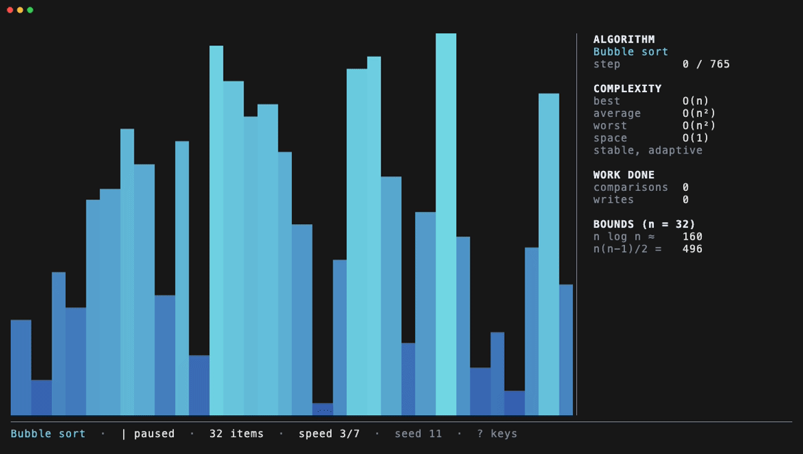

# algoscope

[](https://crates.io/crates/algoscope)
[](https://docs.rs/algoscope)
[](https://github.com/anikag35/algoscope/actions/workflows/ci.yml)

An interactive terminal visualizer for classic algorithms, with step-through
controls and live complexity annotations. Scrub forwards *and backwards*
through a run one operation at a time, and watch the work actually performed
next to the textbook bound for the same input.

Two modes: sorting, and pathfinding on a weighted grid.



The second half of that recording is the part worth pausing on. Dijkstra and
A\* run on the *same* map and find the *same* route — 32 tiles, cost 39 — but
Dijkstra expands 256 of 448 cells and A\* expands 113. That is the argument for
heuristic search in two numbers on one screen, and it works because changing
algorithm deliberately keeps the input fixed.

## Install

```bash
cargo install algoscope
```

Needs a Rust toolchain, 1.88 or newer. Or run it from source:

```bash
git clone https://github.com/anikag35/algoscope && cd algoscope && cargo run --release
```

## Keys

| Key | |
| --- | --- |
| `space` | play / pause |
| `←` `→` or `h` `l` | one step back / forward |
| `pgup` `pgdn` | scrub by a tenth of the run |
| `home` `end` or `g` `G` | jump to the start / end |
| `↑` `↓` or `k` `j` | faster / slower |
| `tab` or `1`–`4` | change algorithm, same input |
| `m` | switch sorting / pathfinding |
| `e` | edit terrain (grid mode) |
| `r` | new input |
| `+` `-` | grow / shrink |
| `?` | all keys |
| `q` | quit |

In edit mode the arrows move a cursor, `space` cycles open → rough → wall, and
`s` / `g` move the endpoints. Every edit re-runs the search and shows the
result, so dropping a wall in front of the route immediately reveals the new
one.

```bash
algoscope --algorithm insertion --size 120 --seed 42
algoscope --mode grid --algorithm astar --grid 60x30
algoscope --ascii          # ASCII glyphs, no colour
```

## How it works

The interesting problem here is not the algorithms, it is the animation state.

The obvious design is to instrument each algorithm so it pauses inline — pass a
tracer, call `tracer.compare(i, j)`, block until the next frame. It reads
naturally and it is a dead end: the *algorithm* owns control flow, so pausing
means parking a thread, and stepping **backwards** is impossible.

So algorithms here never animate themselves. Each runs to completion
immediately and records every operation into an event log:

```rust
pub trait Step: Copy {
    type State: Clone;
    fn apply(self, state: &mut Self::State);
    fn unapply(self, state: &mut Self::State);
}
```

Rendering is then a pure function of `(trace, cursor)`. Stepping forward,
stepping back, scrubbing to an arbitrary position and reverse playback all
collapse into cursor arithmetic over an immutable `Vec<Step>`.

The invariant that buys all of it: **every step carries enough information to
undo itself.** A swap is self-inverse for free. A write is where it gets
interesting — insertion sort shifts values rather than exchanging them, so
without recording the overwritten value there is no way back. Grid steps carry
more still: a cell's previous status, cost and predecessor each.

That constraint is baked into the trait, and `tests/properties.rs` holds it
honest for both modes: for any input, applying every step forward and then
every step backward must return bit-for-bit to the starting state.

`Trace<S>` and `Playback<S>` are generic over the step type, so sorting and
pathfinding share one cursor implementation rather than two that have to be
kept in agreement. `Playback` owns the trace, the state and the cursor
together, so the rendered state cannot drift out of sync with the cursor, and
seeks walk from wherever the cursor already is rather than replaying.

The `algo` module has no dependency on the terminal or on `ratatui`, so the
model is reusable as a library for any other front end.

### Why a grid, not a graph

Breadth-first, depth-first, Dijkstra and A\* are one algorithm with four
frontier orderings — a queue, a stack, a min-heap on cost, and the same heap on
cost plus a heuristic. A weighted grid shows that with no node-layout code at
all, and it reads far better in a terminal than edges drawn between scattered
vertices.

Terrain weights are what make the four diverge. On a grid of uniform cost
Dijkstra degenerates into breadth-first search and the comparison is pointless.
With rough ground at three times the cost of open ground, breadth-first finds
the route with the fewest *tiles* while Dijkstra finds the *cheapest* one — and
they are different routes.

## Portability

It should look right on a modern terminal and stay readable over SSH on
something ancient, so nothing is assumed. Colour depth and UTF-8 support are
detected once at startup, [`NO_COLOR`](https://no-color.org) is honoured, and
every glyph and colour decision routes through one `Theme`.

Here is `--ascii` on the same map. With colour, the terrain glyph fills both
columns of a cell and colour carries the search state; with no colour to spend,
terrain moves to the first column and search state to the second — `#` wall,
`:` rough, `.` open, then `+` frontier, `-` settled, `*` route:

```
.-# # # # .-.-.-.-.-.-.-.-.-.-.-.-.-.-.-.-.-.-.-.-.-.-.-:-:+: : # # |  ALGORITHM
.-# # # # .-.-.-.-.-.-.-:-.-.-.-.-.-.-.-.-.-.-.-.-.-:-:-:-:-:+# # # |  Dijkstra
.-.-.-.-.-.-.-.-.-.-.-.-:-:-.-:-.-.-.-.-.-.-.-.-.-.-:-:-.-.-:-# # # |  step    2,686 / 2,686
.-.-.-.-.-.-.-.-.-.-.-.-:-:-:-:-# # # .-.-.-.-.-.-:-:-:-.-.-.-# # # |
# .-.-.-.-# .-.-.-.-.-.-.-:-:-:-# # # .-.-.-.-.-.-:-:-.-.-# :-:+: # |  COMPLEXITY
# .-:-.-# # .-.-.-.-.-.-.-.-.-# # .-.-.*.*.*.*.-.-.-.-.-.-:-:-:+: # |  best    O(1)
# :-:-.-.-# .-.-.-.-.-.-.-.-.-.-.-.-.-.*# # .*.*.*.-.-.-.-.-:-:+: : |  average O(V log V)
:-:-:-:-# # .-.-.-.-.-.-.-.-.-.-.-.*.*.*:-# :-:-.*.-.-.-.-.-.-.-:+. |  worst   O(V log V)
:-.-:-:-# .*.*.*.*.*.*.*.*.*.*.*.*.*:-:-:-# :-:-.*.*.*.*.*.*.*.*.-.+|  space   O(V)
.-S*.*:*:*:*:-.-.-# # # # .-.-.-.-.-:-:-:-# :-:-:-:-.-.-.-.-# .*G*. |  cheapest route, blind
.-.-:-:-:-:-:-.-.-.-.-# # # .-.-.-.-:-:-:-:-:-:-:-:-.-.-.-.-# # . : |
.-.-:-.-.-:-:-:-.-.-.-.-# # # .-# # :-:-:-# # # .-:-.-.-:-:+: : : : |  SEARCH
.-.-.-.-.-:-:-:-:-:-.-.-.-# # .-# # # # .-.-.-:-# .-:-:-:+: # : : : |  expanded  403
.-.-.-.-.-:-:-:-:-:-.-.-.-.-.-.-# . # # .-.-.-:-.-.+.-:+: : : : : : |  examined  1,420
.-.-# # .-:-# :-:-:-# # # .-.-.-# # # # .-.-.-:-:+: :+: : : . : : : |  relaxed   420
# # # # :-:-# :-:-:-# # .-.-# # # . . # # # .-:+: : . . . . # # : . |  of cells  403 / 612
# . . # :-:-:-.-:-:-# # # # # # . . . # # # .-.-:+: . : . : : : : : |
. . . # :-:-:-.-.-.-# # # . # . . . # # # .+.-.+. : . : : : : : : : |  ROUTE
                                                                    |  tiles     40
====================================================================|  cost      45
Dijkstra  *  = done  *  34x18  *  speed 3/7  *  seed 9  *  ? keys
```

The rest of the fallbacks work the same way: eighth-block bars degrade to an
ASCII ramp, box-drawing borders to `+-|`, and in monochrome the sorting bar
state comes through as reverse and dim video. The sidebar is dropped on a
narrow terminal and the scrubber on a short one, in that order, because the
visualization is the point.

Colour avoids the red/green pairing that red-green colourblind viewers cannot
separate: settled is green, active is amber. The magnitude ramp is a single
blue-to-cyan hue, so it reads by lightness rather than by hue alone.

UTF-8 is *assumed* unless something argues otherwise — no `TERM`, `TERM=dumb`,
`TERM=linux`, or a locale naming `C`, `POSIX` or a non-UTF-8 charset. Requiring
a UTF-8 locale looks more careful but gets the common case backwards: macOS
routinely leaves `LANG` unset while running a perfectly capable terminal.

The data is never resized to fit the terminal, so a resize mid-run cannot
disturb a run in progress.

## Development

```bash
cargo test                 # 112 tests, including property tests over both trace types
cargo clippy --all-targets # clean at -D warnings
vhs demo.tape              # regenerate assets/demo.gif
```

The demo is a committed script rather than a hand-made recording, so it can be
rebuilt after a UI change instead of re-performed. CI runs the tests on Linux,
macOS and Windows, checks formatting and lints, and builds against the declared
MSRV so that claim is tested rather than asserted.

## Dependencies

Three: `ratatui`, `crossterm`, `rand`. Argument parsing is by hand.

## License

MIT or Apache-2.0, at your option.
